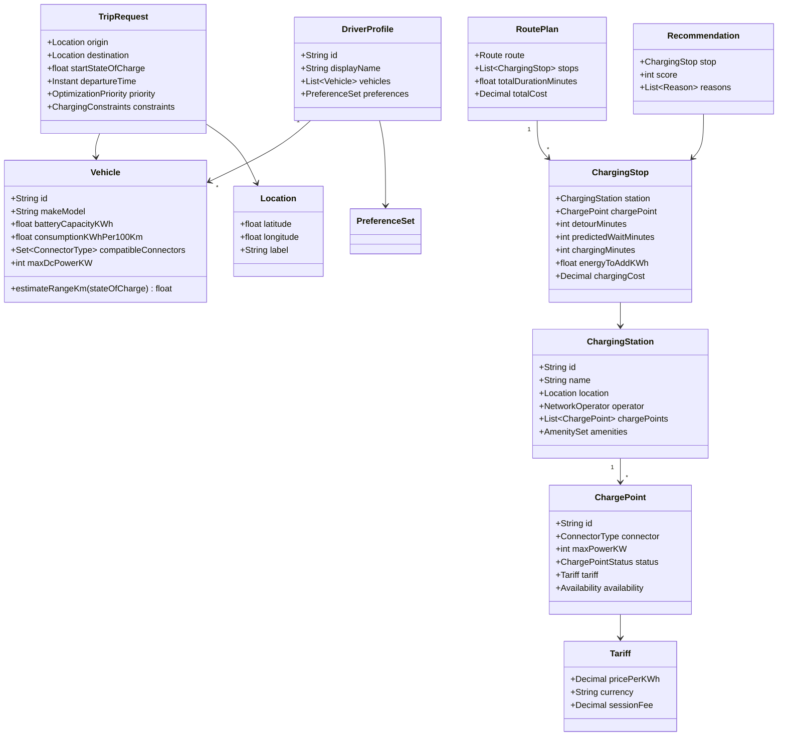
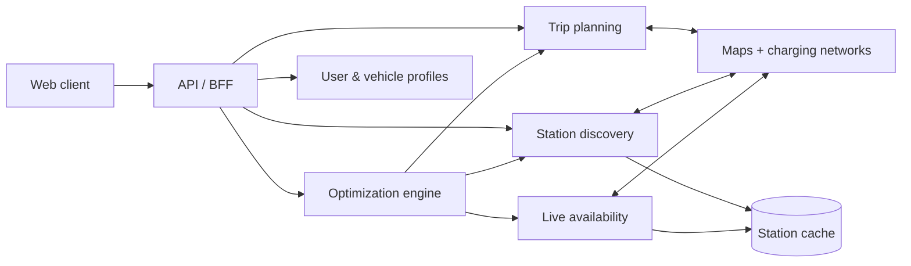

# VoltRoute — Object and subsystem blueprint

## Purpose

VoltRoute selects the best EV charging stop for a planned route. It optimizes a recommendation using the driver's vehicle compatibility, current state of charge, destination, station status, price, detour, and expected charge duration.

The first release is a browser-based prototype using deterministic sample station data. The same interfaces support a future backend connected to live station networks and route providers.

## 1. Domain object design

### Key rules

- `Vehicle` is the source of truth for battery capacity, efficiency, DC charge limit, and supported connectors.
- `TripRequest` is immutable input: it describes one search, not a stored trip.
- A `ChargingStation` is a location. A `ChargePoint` is the actual charger at that location, because availability, connector, speed, and tariff can differ within a site.
- `RoutePlan` holds an executable route and one or more selected `ChargingStop` objects.
- `Recommendation` is an explainable ranked result. It always records the score and the reasons shown to the driver.

## 2. Subsystem design

| Subsystem | Responsibility | Initial prototype | Production direction |
|---|---|---|---|
| Web client | Captures trip inputs and displays map, ranked stops, explanations | Vanilla HTML/CSS/JS | React/Next.js or equivalent |
| Trip planning | Builds route and calculates detours/driving times | Simulated route inputs | Google Maps, Mapbox, or OpenRouteService |
| Station discovery | Finds compatible nearby stations on the route corridor | Local sample dataset | OCPI providers / station-network APIs |
| Live availability | Normalizes port status and occupancy predictions | Sample `available/total/wait` values | Webhooks/polling, short-lived cache |
| Optimization engine | Scores feasible charging stops and creates a route plan | Browser scoring function | Backend service with tested policies |
| User & vehicles | Stores profiles, vehicle capability, preferences, saved trips | Not persisted | Auth + encrypted database |

## 3. Optimization pipeline

1. Validate that the vehicle's present range can safely reach the candidate route corridor.
2. Discard incompatible connectors, offline charge points, and stops beyond the driver's constraints.
3. Estimate detour time, queue time, usable charging power, energy needed, charging time, and price.
4. Score each feasible stop according to the chosen priority:
   - **Balanced:** availability, speed, cost, detour, and queue time.
   - **Fastest arrival:** driving detour, wait, and charging duration dominate.
   - **Lowest cost:** tariff dominates, while retaining safe/reachable options.
5. Return the highest-scoring stop with the inputs that explain why it was recommended.

Current prototype score, normalized to 0–100:

`score = speed × w1 + cost × w2 + route convenience × w3 + availability × w4 + low wait × w5`

Weights change by priority. A production optimizer should also model battery charging curves, weather/elevation, station reliability history, traffic, reservation support, and a minimum arrival state of charge.

## 4. Front-end feature scope

**Implemented in the prototype**

- Origin/destination controls and route swap
- Battery slider that updates estimated range
- Ranked, explainable station recommendations
- Balanced / fastest / cheapest priorities
- Connector and availability filters
- Toggleable sorting, live-status map markers, and mobile layout

**Next integration boundaries**

- Replace the `stations` array in `app.js` with `GET /recommendations?origin&destination&vehicleId&soc&priority`.
- Keep the response in the shape of `Recommendation` above, so the UI does not depend on a provider's raw API data.
- Use server-side provider adapters to map external data into `ChargingStation` and `ChargePoint` before the optimizer sees it.
